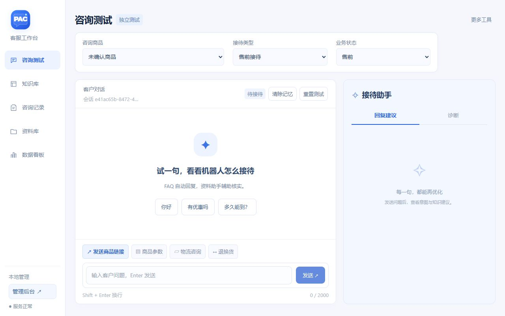
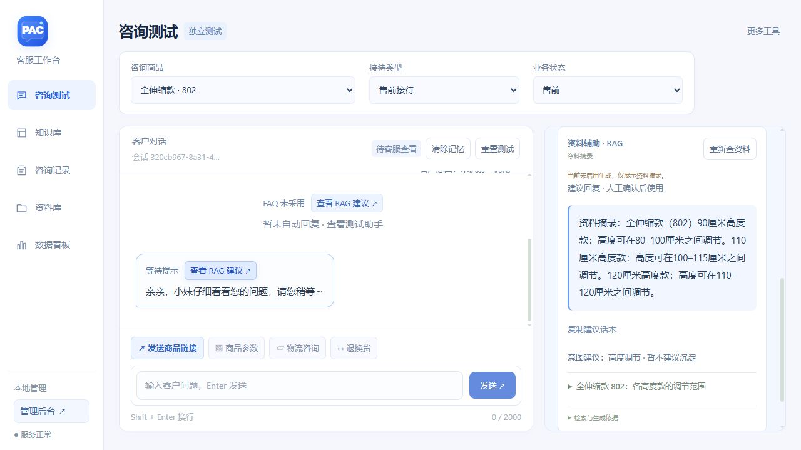

# 电商客服机器人

面向人工实时值守的轻量客服辅助原型，使用 Python、FastAPI 和原生 HTML/CSS/JavaScript。
支持 11 款商品的 FAQ 管理、条件选答、图文回复、RAG 人工辅助与在线接待测试。

公开仓库保留原有四款蚊帐示例数据，新增商品目录与 RAG 资料提供空白结构。云端维护的完整知识库和客户原声不随代码公开；本地及云端现有知识数据保留。商品及话术来自本项目维护资料，
不是通用商品事实；用于其他店铺前应替换、审核。

## 当前功能

以下为程序能力；公开示例不包含云端完整的 11 商品知识与客户原声数据。数据回归测试中的部分用例依赖本地完整知识快照，不能把公开示例的结果等同云端效果。

- PAC 冷白蓝工作台，统一侧栏、手机排版、条件切换反馈和消息交互。
- 发送商品卡片模拟客户咨询：选择商品即可发送，网址选填，不依赖 SKU。
- 回复标明 FAQ、等待提示或澄清追问；可从对应消息打开 RAG 建议。
- 咨询记录与待处理队列、人工评价、应答率／意图识别率／需人工处理率看板。
- 管理员维护正式知识，访客可体验添加意图与配置话术流程，不展示完整知识库。

- 行业、特殊、自定义三层场景，一个场景支持多个问法和多条答案。
- 按商品、售前/售后客服接待、业务阶段、有效时间选择答案。
- 关键词任意/全部匹配，自定义 > 特殊 > 行业优先级，冲突提示人工。
- 网页维护场景、答案和配图，自动备份，保存后生效。
- 商品绑定、跨款推荐、尺寸适配、重复答复抑制。
- 基础字段检索、可选本地语义匹配、可选大模型选择已批准答案。
- 无模型密钥可用 Mock 演示，知识不足时仅提醒工作台。

目前不接入真实电商平台或订单接口，测试状态由操作人员选择。
系统以 FAQ 自动回复为主，另有基于资料检索与真实模型生成的 RAG 人工辅助流程。
RAG 建议带来源，缺资料不编答案；无模型或生成失败时明确提供资料摘录。详见 [FAQ 与 RAG 使用说明](docs/FAQ与RAG使用说明.md)。

## 在 Windows / VS Code 运行

当前验证环境为 Python 3.14。进入仓库目录后，在终端执行：

```powershell
python -m venv .venv
.\.venv\Scripts\python.exe -m pip install -r requirements.txt
Copy-Item .env.example .env
.\.venv\Scripts\python.exe -m uvicorn app.main:app --host 127.0.0.1 --port 8002
```

- 接待测试：<http://127.0.0.1:8002/>
- 知识库管理：<http://127.0.0.1:8002/knowledge>
- RAG 资料维护：<http://127.0.0.1:8002/materials>
- 接口文档：<http://127.0.0.1:8002/docs>

启动后保持服务运行。关闭网页不会删除资料；服务退出后需要重新启动。
会话保存在内存中，重启后清空；已保存的知识库仍在文件中。

## 桌面双击启动（当前电脑已配置）

双击 Windows 桌面的 **电商客服机器人** 图标。启动器会在后台启动本地服务，等待就绪后打开
默认浏览器；服务已经在运行时直接打开，不会重复启动。电脑重启后再次双击即可。
关闭网页不会停止后台服务。不需要保持 PowerShell 窗口打开，也不需要修改执行策略。

项目文件夹内的 `启动客服机器人.cmd` 也可双击。桌面快捷方式指向本机 Python 和当前项目位置，
移动项目后需更新快捷方式。启动日志在 `logs/launcher.log` 和 `logs/desktop-*.log`。
本启动器不安装开机启动项；依然只监听本机的 `127.0.0.1:8002`。

如需手动启动，在项目目录打开 PowerShell，执行：

```powershell
python -m uvicorn app.main:app --host 127.0.0.1 --port 8002
```

## 配置模型

只在本地 `.env` 填写 `MODEL_API_KEY`。默认火山 Seed 2.0 Lite：

```dotenv
MODEL_MODE=auto
MODEL_PROVIDER=volcengine
MODEL_BASE_URL=https://ark.cn-beijing.volces.com/api/v3
MODEL_NAME=doubao-seed-2-0-lite-260428
MODEL_THINKING=false
```

可更换兼容接口和模型 ID。真实调用取决于账号权限、余额和网络。
设置 `MODEL_MODE=mock` 可始终使用本地演示模式。
`.env`、日志、备份、虚拟环境和模型权重不会上传到 GitHub。

## 可选：本地语义匹配

基础 FAQ 功能不要求下载模型。需要句向量匹配时执行：

```powershell
.\.venv\Scripts\python.exe -m pip install -r requirements-semantic.txt
.\.venv\Scripts\python.exe scripts/download_semantic_model.py
```

脚本下载固定版本数据，并校验 ONNX 模型的 SHA-256。权重不在 Git 中；
下载失败不影响基础 FAQ。详见 [语义检索说明](docs/语义检索运行说明.md)。

## 测试

```powershell
$env:MODEL_MODE="mock"
.\.venv\Scripts\python.exe -m unittest discover -s tests -q
```

项目完整验证为 367 项测试通过。未下载本地向量模型时，相关测试会跳过。
主动运行 `scripts/check_model.py` 且启用真实模型时，会联网使用虚构 FAQ 验证接口。
部署镜像已在本机完成 Linux 构建及临时容器验证；独立检查脚本为 `scripts/check_deployment.py`。
尚未在云服务器配置域名、验证 HTTPS 或开放公网链接。

## 文件位置

| 路径 | 用途 |
| --- | --- |
| `app/` | 接口、商品上下文、场景条件、检索和模型调用 |
| `static/` | 接待页、知识库页和图片 |
| `data/faq.json` | 场景、条件答案、关键词和图片引用 |
| `data/nets_801_804.json` | 结构化参数及尺寸校验资料 |
| `data/source_qa.json` | 原表问答溯源 |
| `data/image_catalog.json` | 图片清单 |
| `data/backups/` | 本地自动备份，不上传 |
| `logs/events.jsonl` | 本地诊断日志，不上传 |
| `tests/` | 自动化测试 |

详细操作见 [场景与条件答案使用说明](docs/场景与条件答案使用说明.md)。
早期版本保留在 [历史开发记录](docs/历史开发记录.md)，以当前说明为准。

## 部署范围

默认仍仅监听 `127.0.0.1`。上传 GitHub 用于保存和管理项目，不会自动部署为在线网站。
已提供公网体验模式、后台鉴权、访客会话隔离和调用限额，以及 Docker Compose / HTTPS 部署文件。
已部署在线体验：[PAC 客服工作台](https://14.103.103.60/)。后台管理需要管理员登录。
自行部署请使用根目录的 Dockerfile 和 compose.yaml；安装与验收步骤见 [公网部署说明](docs/公网部署说明.md)。
deploy/cloud-ip 中的增量镜像文件用于现有服务器的版本更新，依赖此前镜像，不能代替首次构建。

## 界面预览






测试消息下仅显示“客户意图：XXX”和“优化”。点击客户问题或“优化”，右侧测试助手显示简短原因、
知识维护建议及操作入口；识别方式、命中问法、候选意图、来源、条件排除原因和错误类型收在“查看依据”。
快捷入口可预填答案编辑器、拓展问法或新意图，必须由训练者确认保存。建议只依据现有检索与知识配置，
不会编造商品答案、直接对客发送或自动启用新知识。保存后点击“重新测试原问题”。原问题和测试条件
在本机浏览器暂存30分钟，不放入跳转地址。未识别、条件不符、答案冲突、重复拦截、系统异常分别提示，
这些提示仅供工作台查看。稳定性与承重是两个独立意图，允许复用同一核准话术和图片。

目前使用规则 / 精确问法、预训练多语言句向量模型，以及可选的 Seed 大模型候选选择，
没有为本店训练独立的监督式意图分类器。新增问法会重建检索索引，不会训练模型。
意图描述用于说明维护边界；不能把相似度当正确率，也不把候选意图显示为确定识别结果。


咨询测试右上角提供两个操作：清除记忆会清空当前对话、候选商品卡片、重复回复记录与等待任务，
并保留商品和接待条件；重置测试还会取消商品选择，把接待类型与业务状态恢复为售前。
现有商品答案均限定“售前接待 + 售前业务状态”，新建答案默认也勾选售前。
字段检索已经命中有效FAQ时直接返回核准答案，不再额外调用模型；原始诊断可在右侧展开查看。

四款的长宽调节、高度调节、完整伸缩范围与套装结构分开维护。明确高度规格时只发送该规格，
“我问的是长宽”“那110高呢”等相邻追问保留调节属性；切商品、清除记忆或转问其他话题后不继承。
连续纠正仍未解决时提示人工核对，不把问号原声直接当作新知识。
四款均包含支架、遮光帘、帐纱，帐纱套在最外层。参数来源为2026-10-22商家确认。

已回复的单条FAQ旁可点“修改答案”，直接在新标签页打开知识库对应条目的完整编辑器，可修改话术、分条回复、商品及接待条件；保存后可按原测试条件复测。多来源合成答复不提供单条覆盖入口。

“好的、好哒、明白了”等独立肯定问法归入“肯定／已了解”，默认回复一个 💗，问法和回复均可在知识库维护；带后续问题的句子优先处理问题，疑问句不按肯定处理。
旧聊天气泡保留用于对照；多来源或计算答复不直接覆盖。每个文本框代表一个消息气泡，框内换行
保留在同一气泡；知识库编辑器也支持此设置。两条重复原表记录保留为来源引用，不作为独立答案
候选或维护卡片，避免主答案修改或停用后旧副本重新生效。
